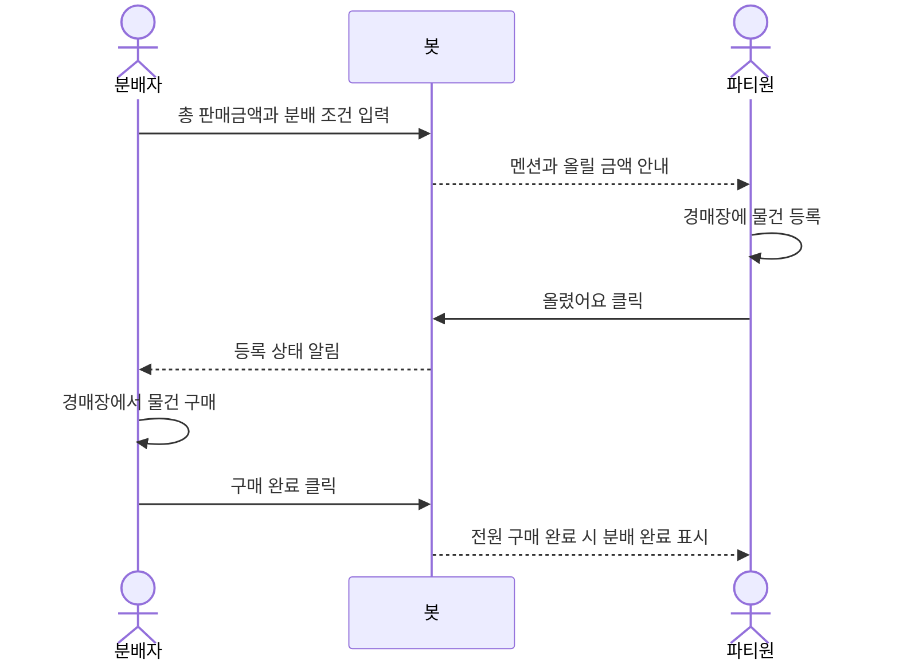

<div align="center">

# 🐒 ricemonkey-bot

**메이플스토리 보스 리워드, 보내는 금액 말고 손에 쥐는 금액까지 정확하게.**

경매장 수수료를 고려한 분배 계산과 진행 확인을 목표로 만드는 Discord 봇이에요.


[왜 필요한가요?](#why) · [기능 계획](#features) · [분배 원리](#math) · [시작하기](#start) · [로드맵](#roadmap) · [문서](#docs)

</div>

---

<a id="why"></a>
## 🤔 반으로 나눴는데, 왜 내 몫이 적죠?

보스 리워드를 팔고 남은 **95,000,000메소**. 둘이 나누니 **47,500,000메소**씩이면 될까요?
파티원이 그 금액으로 경매장에 물건을 올리면 수령할 때 수수료 **3%**가 한 번 더 빠져요.
파티원은 **46,075,000메소**, 분배자는 **47,500,000메소**. 차이는 **1,425,000메소**예요.

ricemonkey-bot은 **각자 최종적으로 받는 금액**을 기준으로 올릴 금액을 역산하는 방식으로 설계했어요.

| 2명 정분배 · 판매 실수령액 95,000,000메소 | 단순 반분 | 역산 분배 설계 |
|---|---:|---:|
| 파티원이 경매장에 올릴 금액 | 47,500,000 | 48,223,350 |
| 분배자가 최종적으로 갖는 금액 | 47,500,000 | 46,776,650 |
| 파티원이 수수료를 빼고 받는 금액 | 46,075,000 | 46,776,649 |

끝자리까지 항상 같지는 않아요. 메소는 정수라 소수점은 버리고, 남는 메소는 분배자에게 돌아가요.
**위 표는 도메인 설계의 계산 예시이며, 아직 봇에서 실행할 수 있는 기능은 아니에요.**

## 🚧 지금은 어디까지 만들었나요?

> [!NOTE]
> **현재는 뼈대만 있어요.** `discord-hono`를 통한 Discord 요청 서명 검증과 PING → PONG 응답, 이를 확인하는 테스트 6개가 있어요.
> 명령, 분배 계산, DB 스키마는 아직 구현하지 않았고, 실제 배포도 하지 않았어요.
> 아래 기능과 사용 흐름은 모두 **구현 계획**이에요. 지금 바로 초대해 사용하는 봇은 아니에요.

<a id="features"></a>
## ✨ 기능 계획 — 계산부터 완료 확인까지

| 계획한 기능 | 목표 동작 |
|---|---|
| 분배 만들기 | 총 판매금액, 판매 수수료, 파티원, 선택 분배 퍼센트를 입력받아요. |
| 수수료 역산 | 분배자 포함 최대 6명, 판매 수수료 3% 또는 5%, 파티원 수령 수수료 3%를 반영해요. |
| 정분배와 비율 분배 | 기본은 정분배예요. 일부 비율만 지정하면 남은 비율을 나머지 인원이 똑같이 나눠요. |
| 금액 안내 | 파티원을 멘션하고 각자 올릴 금액과 예상 실수령액을 보여줘요. |
| 올렸어요 · 구매 완료 | 파티원 본인만 등록 표시를, 분배자만 구매 완료 표시를 할 수 있게 해요. |
| 완료 · 취소 | 전원 구매 완료 시 분배를 완료해요. 잘못 만든 분배는 분배자가 취소할 수 있게 해요. |
| 미완료 · 내역 조회 | 내가 올릴 건과 구매할 건을 조회하고, 참여 내역은 조회한 본인에게만 보여줘요. |
| 입력 검증 · 기록 보관 | 중복·봇·분배자 본인 참여와 0 이하 금액을 거부하고, 완료·취소 기록도 보관해요. |

구매 완료는 등록 표시 없이도 누를 수 있게 할 계획이에요. 말로만 등록을 알린 경우도 처리하려고 해요.
**봇은 게임 안의 거래를 확인하거나 구매하지 않아요.** 사람이 누른 표시만 관리하며, 취소해도 이미 한 거래는 되돌리지 못해요.
아이템별 드랍 기록, 고정 파티 저장, 넥슨 Open API 연동은 1차 범위에서 제외했어요.

## 🔁 이렇게 사용할 계획이에요

명령 이름과 실제 화면은 아직 정하지 않았어요. 아래는 구현할 상호작용 흐름이에요.



<a id="math"></a>
## 🧮 분배 원리 — 수수료를 먼저 계산해요

기준은 총 판매금액이 아니라 **판매 수수료를 뺀 실수령액**이에요.
분배 퍼센트는 분배자까지 포함해 합계가 100%여야 하고, 맞지 않으면 분배를 만들지 않을 계획이에요.
아래 식에서 퍼센트는 `50`처럼 백분율 숫자로 넣어요.

```text
판매 실수령액 = 총 판매금액 - 총 판매금액의 판매 수수료
파티원 올릴 금액 = 판매 실수령액 × 파티원 퍼센트 ÷ (100 - 0.03 × 분배자 퍼센트)
분배자 최종 금액 = 판매 실수령액 - 파티원별 올릴 금액의 합
```

올릴 금액은 소수점을 버려요. 아래는 [도메인 문서의 계산 예시](docs/domain.md) 중 정분배 사례를 그대로 옮긴 표예요.
총 판매금액은 모두 **100,000,000메소**, 파티원 금액은 **1인당**이며 실수령액의 끝수도 버려서 적었어요.

| 판매 수수료 | 분배 퍼센트 | 판매 실수령액 | 파티원 올릴 금액 | 분배자 최종 금액 | 파티원 실수령액 |
|---|---|---:|---:|---:|---:|
| 5% | 2명 정분배 | 95,000,000 | 48,223,350 | 46,776,650 | 46,776,649 |
| 3% | 2명 정분배 | 97,000,000 | 49,238,578 | 47,761,422 | 47,761,420 |
| 5% | 3명 정분배 | 95,000,000 | 31,986,531 | 31,026,938 | 31,026,935 |
| 5% | 6명 정분배 | 95,000,000 | 15,912,897 | 15,435,515 | 15,435,510 |

## 🛠️ 기술 스택

버전은 현재 `package.json`에 고정된 값을 기준으로 적었어요.

| 구성 | 기술 · 버전 | 역할 또는 계획 |
|---|---|---|
| 언어 | TypeScript `7.0.2` | 타입 검사 |
| 실행 환경 | Cloudflare Workers · Wrangler `4.156.0` | HTTP 요청 처리와 개발·배포 도구 |
| Discord 연동 | discord-hono `0.23.0` · Hono `4.13.14` | 현재 서명 검증과 PING 응답 |
| API 타입 | discord-api-types `0.38.57` | Discord API 타입 정의 |
| 테스트 | Vitest `5.0.5` | 서명 검증과 PING 응답 테스트 |
| 저장소 계획 | Cloudflare D1 | 분배 기록·상태 저장 예정, 스키마 미구현 |
| 로컬 런타임 | Node.js `>=24` | npm 명령과 테스트 실행 |

**왜 서버리스인가요?** 슬래시 명령과 버튼을 HTTP Interactions로 처리하면 Gateway 상시 연결 없이 요청 때만 실행할 수 있어요.
상시 서버를 직접 관리하지 않는 구성이 목표예요. Workers·D1 무료 플랜을 전제로 설계했지만, 실제 배포는 아직 검증하지 않았어요.
무료 조건과 한도는 바뀔 수 있으니 [아키텍처 문서](docs/architecture.md)의 출처도 확인해 주세요.

<a id="start"></a>
## 🚀 시작하기 — 현재 뼈대 실행

### 로컬 준비

Node.js 24 이상과 npm을 설치한 뒤, 프로젝트 루트의 PowerShell에서 실행해 주세요.

```powershell
npm ci
Copy-Item .dev.vars.example .dev.vars
```

`.dev.vars`의 `DISCORD_PUBLIC_KEY`에 Discord Developer Portal의 공개 키를 입력해 주세요.
`DISCORD_APPLICATION_ID`와 `DISCORD_TOKEN`은 라이브러리가 사용하는 이름이며, 현재 PING 처리에는 필요하지 않아요.
**실제 토큰이나 `.dev.vars`는 절대 공개 저장소에 커밋하지 마세요.**

```powershell
npm run dev
```

로컬 서버의 `/`로 POST 요청을 보내면 유효한 Discord 서명과 PING 본문에 `200`과 `{"type":1}`을 반환해요.
서명이 없거나 일치하지 않으면 `401`을 반환해요. 로컬 개발에는 Cloudflare 계정이나 원격 D1 생성이 필요하지 않아요.

### 검사

```powershell
npm run typecheck
npm test
npx wrangler deploy --dry-run
```

테스트는 Node에서 실행하며 매번 Ed25519 키 쌍을 생성해요. 실제 Discord 자격 증명은 필요하지 않아요.
`--dry-run`은 배포 산출물을 점검하는 명령이며, 실제 배포나 Discord 연동 성공을 보장하지 않아요.

### 실제 배포 전 주의

`wrangler.jsonc`의 `database_id`는 **자리표시자**예요.
추후 `npx wrangler d1 create ricemonkey-bot`을 실행하고 출력된 ID로 교체해야 해요.
Cloudflare 인증과 필요한 비밀값도 별도로 설정해야 하며, DB 스키마 구현과 첫 배포 검증은 아직 남아 있어요.
**`npm run deploy`는 실제 배포를 실행해요.** 로컬 검사 명령으로 사용하지 말고 준비가 끝난 뒤에만 실행해 주세요.

## 📁 프로젝트 구조

현재 존재하는 주요 파일만 표시했어요.

```text
ricemonkey-bot/
├── docs/
│   ├── domain.md               # 분배 규칙과 계산 예시
│   ├── features.md             # 1차 기능 범위
│   ├── architecture.md         # 기술 선택과 미검증 사항
│   └── workflow.md             # 브랜치, 커밋, 버전, 릴리스 규칙
├── src/
│   └── index.ts                # DiscordHono 진입점
├── test/
│   └── interactions.test.ts    # 서명 검증과 PING 테스트
├── .dev.vars.example           # 로컬 환경변수 예시
├── package.json                # 의존성과 실행 명령
├── package-lock.json           # 의존성 잠금 파일
├── tsconfig.json               # TypeScript 설정
├── wrangler.jsonc              # Workers와 D1 바인딩 설정
└── README.md
```

<a id="roadmap"></a>
## 🗺️ 로드맵

- [x] 도메인·기능·아키텍처 문서 작성
- [x] TypeScript + Workers + DiscordHono 뼈대 구성
- [x] 서명 검증·PING 응답 테스트 6개 작성
- [ ] 분배 계산과 입력 검증 구현
- [ ] D1 스키마와 분배·파티원 상태 저장 구현
- [ ] 분배 생성·금액 안내·버튼 권한·완료·취소 구현
- [ ] 미완료 조회와 본인 전용 내역 조회 구현
- [ ] 첫 배포에서 Workers·D1만 사용할 때 카드 없이 가입 가능한지 확인
- [ ] 첫 배포에서 서명 검증과 DB 처리가 CPU 10ms 안에 들어오는지 측정
- [ ] 첫 배포에서 Gateway 접속 없이 봇 토큰으로 일반 API를 호출할 수 있는지 확인
- [ ] 완료 이모지의 일반 API 호출이 불가능하면 메시지 내 완료 표시로 대체
- [ ] 실제 배포 후 Discord → Workers → D1 전체 흐름 검증

<a id="docs"></a>
## 📚 설계 문서

- [도메인](docs/domain.md) — 용어, 수수료, 역산 공식과 계산 예시
- [기능 명세](docs/features.md) — 역할, 입력 검증, 조회와 취소 범위
- [아키텍처](docs/architecture.md) — 기술 선택, 구현 제약, 무료 한도와 미검증 사항
- [작업 규칙](docs/workflow.md) — 브랜치, 커밋, 버전, 릴리스

## 📄 라이선스

라이선스는 아직 정하지 않았어요. 현재 저장소에는 `LICENSE` 파일이 없어요.
