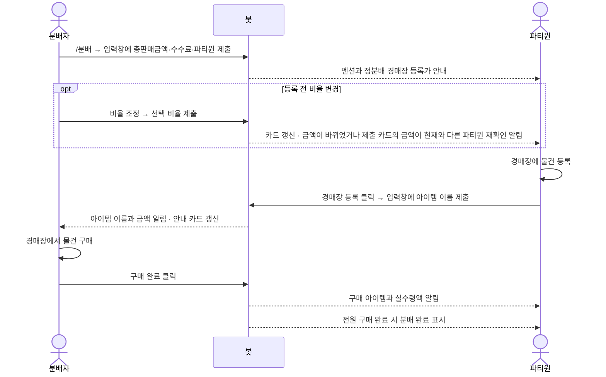

<div align="center">

# 🐒 ricemonkey-bot

**메이플스토리 보스 리워드, 보내는 금액 말고 손에 쥐는 금액까지 정확하게.**

경매장 수수료를 고려한 분배 계산과 진행 확인을 목표로 만드는 Discord 봇이에요.


[왜 필요한가요?](#why) · [기능 계획](#features) · [분배 원리](#math) · [시작하기](#start) · [로드맵](#roadmap) · [문서](#docs)

</div>

---

<a id="why"></a>
## 🤔 반으로 나눴는데, 왜 내 몫이 적죠?

보스 리워드를 팔고 남은 **95,000,000메소**. 둘이 나누니 **47,500,000메소**씩이면 될까요?
파티원이 그 금액으로 경매장에 물건을 올리면 수령할 때 수수료 **3%**가 한 번 더 빠져요.
파티원은 **46,075,000메소**, 분배자는 **47,500,000메소**. 차이는 **1,425,000메소**예요.

ricemonkey-bot은 **각자 최종적으로 받는 금액**을 기준으로 경매장 등록가를 역산하는 방식으로 설계했어요.

| 2명 정분배 · 판매 실수령액 95,000,000메소 | 단순 반분 | 역산 분배 설계 |
|---|---:|---:|
| 파티원의 경매장 등록가 | 47,500,000 | 48,223,350 |
| 분배자가 최종적으로 갖는 금액 | 47,500,000 | 46,776,650 |
| 파티원이 수수료를 빼고 받는 금액 | 46,075,000 | 46,776,649 |

끝자리까지 항상 같지는 않아요. 메소는 정수라 소수점은 버리고, 남는 메소는 분배자에게 돌아가요.
**위 계산은 `/분배` 명령에 연결했고, 로컬 D1 테스트와 Wrangler 실행으로 확인했어요. 소유자의 테스트 서버 확인 기록은 [다음 할 일](docs/todo.md)에 있어요. 현재 코드 버전은 `package.json`, 릴리스 버전은 [GitHub 태그](https://github.com/JinDevLab/ricemonkey-bot/tags)를 확인해 주세요.**

## 🚧 지금은 어디까지 만들었나요?

> [!NOTE]
> **분배 계산과 진행 관리 기능을 구현했어요.** 서명 검증·PING 응답, D1 저장, `/분배`·`/미완료`·`/내역`, 버튼 권한·완료·취소, 자동 삭제·카드 재게시·알림 복구가 있어요.
> **2026-10-31 1.0.0을 배포했어요.** Worker Version ID는 `f98a63de-7aca-4687-9599-cac7af15233c`이고, cron `0 18 * * *`(매일 KST 03:00) 등록을 배포 출력에서 확인했어요. 명령 정의가 바뀌지 않아 재등록하지 않았어요.
> 테스트 서버 확인 기록과 소유자의 1.0 판단 결정은 [다음 할 일](docs/todo.md)에 구분해 기록해요. 실제 Discord 카드 재게시, 예약 실행 결과·Cron 이벤트와 삭제 실패 표시는 미확인이며, 소유자의 Privacy Policy URL 입력·GitHub 보안 설정도 그 문서에서 관리해요.
> 실제 파티 사용과 전역 명령 표시는 소유자 결정으로 1.0 판단에서 확인된 것으로 간주하며, 실제 실행 기록을 뜻하지 않아요.

<a id="features"></a>
## ✨ 기능 — 계산부터 완료 확인까지

| 구현한 기능 | 동작 |
|---|---|
| 분배 만들기 | `/분배`를 실행하면 입력창이 열려요. 총판매금액, 판매 수수료(3%/5%), 본인을 제외한 파티원 1~5명을 받고 정분배로 만들어요. 금액은 `240,000,000`처럼 세 자리마다 쉼표를 넣어도 돼요. |
| 비율 조정 | 아무도 경매장 등록을 제출하지 않은 진행 중 카드에서 분배자만 `비율 조정`을 눌러 바꿔요. 금액이 바뀌었거나, 제출한 카드의 금액이 현재와 다른 파티원에게 다시 확인하라는 알림을 보내요. |
| 수수료 역산 | 분배자 포함 최대 6명, 판매 수수료 3% 또는 5%, 파티원 수령 수수료 3%를 반영해요. |
| 정분배와 비율 분배 | 기본은 정분배예요. 일부 비율만 지정하면 남은 비율을 나머지 인원이 똑같이 나눠요. 안내 카드에서는 분배자와 0% 제외 파티원의 정확한 비율이 같으면 숨기고 다르면 모두 표시해요. 소수점 둘째 자리 반올림 때문에 표시 합계는 100%가 아닐 수 있어요. |
| 금액 안내 | 파티원을 멘션하고 임베드 카드에 각자 경매장 등록가·실수령액·등록한 아이템·진행 상태를 보여줘요. |
| 경매장 등록 · 구매 완료 | 파티원 본인이 입력창에 경매장 아이템 이름을 등록·수정하고, 분배자는 이름과 금액을 확인해 구매 완료 표시를 해요. |
| 완료 · 취소 | 전원 구매 완료 시 분배를 완료해요. 잘못 만든 분배는 분배자가 취소할 수 있게 해요. |
| 미완료 · 내역 조회 | 내가 올릴 건과 구매할 건을 조회하고, 참여 내역은 조회한 본인에게만 보여줘요. |
| 입력 검증 · 기록 보관 | 중복·봇·분배자 본인 참여와 0 이하 금액을 거부하고, 모든 상태의 기록을 생성 후 3개월 보관하고 매일 자동 삭제해요. |

경매장 등록 전에는 구매 완료 버튼이 잠기고, 서버에서도 구매를 거절해요. 파티원이 `경매장 등록`을 눌러 이름을 제출해야 구매 완료가 가능하며, 누르기 전에는 분배자가 비율을 조정하거나 취소할 수 있어요. 실제 구매 완료 시 해당 파티원에게 아이템 이름과 실수령액을 공개 알림으로 보내며 분배자에게는 알림이 가지 않아요. 예전 등록 기록의 이름이 비어 있어도 구매는 가능해요.
경매장 등록 입력창에 현재 등록가를 표시해 게임에 올린 금액을 다시 확인하게 해요. 입력창을 연 뒤 비율이 바뀌어 등록가가 달라지면 제출을 저장하지 않고 새 금액과 버튼 재클릭을 안내해요. 저장 직전의 금액 변경도 막으며, 옛 형식 입력창은 다시 열어야 해요. 0%로 제외된 파티원에게는 이미 올렸다면 내려 달라고 알려요. 옛 카드에서 비율을 제출하면 이미 알림을 받은 파티원에게 중복 알림이 갈 수 있어요.
**봇은 게임 안의 거래를 확인하거나 구매하지 않아요.** 사람이 누른 표시만 관리하며, 취소해도 이미 한 거래는 되돌리지 못해요.
아이템별 드랍 기록, 고정 파티 저장, 넥슨 Open API 연동은 1차 범위에서 제외했어요.

## 🔁 이렇게 사용해요

서버 안에서 `/분배`로 만들고 `/미완료`·`/내역`으로 조회해요. 세 명령 모두 서버 전용이며 DM에서는 사용할 수 없어요. 조회는 본인에게만 보이며, 현재 서버의 내역은 취소 건을 제외한 최근 10건까지 보여줘요. 완료·취소·진행 중 기록 모두 생성 후 3개월이 지나면 매일 KST 03:00에 삭제해요. 미완료는 올릴 건·구매할 건 각각 오래된 순 10행이고, 더 있으면 알려줘요. 번호를 선택하면 원래 채널에서만 알림 없이 공개 카드를 다시 올려요. 다른 채널이면 원래 채널에서 `/미완료`를 실행해 주세요. 분배자와 제외되지 않은 파티원만 가능하며 옛 카드도 계속 쓸 수 있어요. `/미완료`에 나오는 건만 고를 수 있고, 이미 등록을 마친 파티원은 본인 목록에 안 나오므로 분배자가 다시 올려야 해요. 원래 채널이 지워지면 다시 올릴 수 없고 생성 후 3개월 뒤 자동 삭제돼요. 삭제된 분배의 옛 버튼은 `분배를 찾을 수 없어요.`라고 안내해요.



<a id="math"></a>
## 🧮 분배 원리 — 수수료를 먼저 계산해요

기준은 총판매액이 아니라 **판매 수수료를 뺀 실수령액**이에요.
새 분배는 정분배예요. 카드의 `비율 조정` 입력창에서 바꿀 수 있고, 모두 지정할 때는 분배자까지 합계 100%여야 해요. 일부만 지정하면 빈 칸(공백만 있는 칸 포함)의 인원이 남은 몫을 나눠요. 파티원이 4명 이하면 분배자 칸도 보여요. 5명이면 분배자 칸은 없고, 다섯 칸을 모두 채우면 분배자가 나머지를 받아요(합이 100%면 분배자 0%). 빈 칸이 있으면 분배자도 그 사람들과 남은 몫을 똑같이 나눠요. 0%로 제외된 파티원도 다시 조정할 수 있어요.
아래 식에서 퍼센트는 `50`처럼 백분율 숫자로 넣어요. 비율 입력창에는 `50%`처럼 끝에 `%` 하나를 붙여도 돼요. 합계가 맞지 않거나 전원 0%이면 기존 카드를 바꾸지 않아요.

```text
판매 실수령액 = 총판매액 - 총판매액의 판매 수수료
파티원 경매장 등록가 = 판매 실수령액 × 파티원 퍼센트 ÷ (100 - 0.03 × 분배자 퍼센트)
분배자 최종 금액 = 판매 실수령액 - 파티원별 경매장 등록가의 합
```

경매장 등록가는 소수점을 버려요. 아래는 [도메인 문서의 계산 예시](docs/domain.md) 중 정분배 사례를 그대로 옮긴 표예요.
총판매액은 모두 **100,000,000메소**, 파티원 금액은 **1인당**이며 실수령액의 끝수도 버려서 적었어요.

| 판매 수수료 | 분배 퍼센트 | 판매 실수령액 | 파티원 경매장 등록가 | 분배자 최종 금액 | 파티원 실수령액 |
|---|---|---:|---:|---:|---:|
| 5% | 2명 정분배 | 95,000,000 | 48,223,350 | 46,776,650 | 46,776,649 |
| 3% | 2명 정분배 | 97,000,000 | 49,238,578 | 47,761,422 | 47,761,420 |
| 5% | 3명 정분배 | 95,000,000 | 31,986,531 | 31,026,938 | 31,026,935 |
| 5% | 6명 정분배 | 95,000,000 | 15,912,897 | 15,435,515 | 15,435,510 |

## 🛠️ 기술 스택

버전은 현재 `package.json`에 고정된 값을 기준으로 적었어요.

| 구성 | 기술 · 버전 | 역할 또는 계획 |
|---|---|---|
| 언어 | TypeScript `7.0.2` | 타입 검사 |
| 실행 환경 | Cloudflare Workers · Wrangler `4.156.0` | HTTP 요청 처리와 개발·배포 도구 |
| Discord 연동 | discord-hono `0.23.0` · Hono `4.13.14` | 서명 검증, 명령과 버튼 응답 |
| API 타입 | discord-api-types `0.38.57` | Discord API 타입 정의 |
| 테스트 | Vitest `5.0.5` | 계산·서명 검증·로컬 D1 통합 테스트 |
| 저장소 | Cloudflare D1 | 분배 기록·상태 저장, 초기 마이그레이션 |
| 로컬 런타임 | Node.js `>=24` | npm 명령과 테스트 실행 |

**왜 서버리스인가요?** 슬래시 명령과 버튼을 HTTP Interactions로 처리하면 Gateway 상시 연결 없이 요청 때만 실행할 수 있어요.
상시 서버를 직접 관리하지 않는 구성이에요. Workers·D1 무료 플랜을 전제로 테스트 서버에 배포했으며, 실제 사용량과 CPU 한도는 확인 중이에요.
무료 조건과 한도는 바뀔 수 있으니 [아키텍처 문서](docs/architecture.md)의 출처도 확인해 주세요.

<a id="start"></a>
## 🚀 시작하기 — 로컬 실행

### 로컬 준비

Node.js 24 이상과 npm을 설치한 뒤, 프로젝트 루트의 PowerShell에서 실행해 주세요.

```powershell
npm ci
Copy-Item .dev.vars.example .dev.vars
```

`.dev.vars`의 `DISCORD_PUBLIC_KEY`에 Discord Developer Portal의 공개 키를 입력해 주세요.
`DISCORD_APPLICATION_ID`와 `DISCORD_TOKEN`은 명령 등록에 필요해요. 토큰이 없으면 분배 상태 변경은 동작하지만 등록·구매·비율 변경 알림과 완료 리액션은 건너뛰어요. callback·알림 실패 시 DB 상태는 유지하고 자동 재시도하지 않아요. `DISCORD_GUILD_ID`는 명령 등록을 테스트 서버로 한정할 때 입력해요.
**실제 토큰이나 `.dev.vars`는 절대 공개 저장소에 커밋하지 마세요.**

```powershell
npx wrangler d1 migrations apply ricemonkey-bot --local
npm run dev
```

로컬 서버의 `/`로 POST 요청을 보내면 유효한 Discord 서명과 PING 본문에 `200`과 `{"type":1}`을 반환해요.
서명이 없거나 일치하지 않으면 `401`을 반환해요. 로컬 개발에는 Cloudflare 계정이나 원격 D1 생성이 필요하지 않아요.

### 검사

```powershell
npm run typecheck
npm test
npx wrangler deploy --dry-run
```

테스트는 Node에서 실행하며 매번 Ed25519 키 쌍을 생성해요. 실제 Discord 자격 증명은 필요하지 않아요.
`--dry-run`은 배포 산출물을 점검하는 명령이며, 실제 배포나 Discord 연동 성공을 보장하지 않아요.

### 배포와 명령 등록

배포·명령 등록의 확인 시점과 결과는 [다음 할 일](docs/todo.md)에 기록해요. 현재 버전은 `package.json`과 [GitHub 태그](https://github.com/JinDevLab/ricemonkey-bot/tags)를 참고하고, 운영 중인 Worker와 명령 상태는 릴리스 때 별도로 확인해 주세요. 다른 환경을 만들 때는 별도 DB와 비밀값을 설정해 주세요. 필요한 D1 구조는 `migrations/`의 마이그레이션을 순서대로 적용해요.

등록은 `npm run register:global` 또는 `npm run register:guild`로 대상을 명시해요. 전역 등록은 `DISCORD_GUILD_ID`를 무시하고, 테스트 서버 등록은 그 값이 필수예요. 서버 지정 등록을 하면 전역 명령과 겹쳐 보일 수 있어요. 명령 정의를 바꿨다면 새 입력을 처리할 Worker를 먼저 배포한 뒤 등록해 주세요.

**`npm run deploy`와 등록 명령은 실제 서비스에 반영돼요.** 수동 릴리스 순서는 [작업 규칙](docs/workflow.md)을 따라 주세요.

### 서버 관리자용 초대와 권한

Discord Developer Portal의 앱 설치 설정에서 서버 설치(Guild Install)를 사용하고 `bot`, `applications.commands` 범위의 초대 링크로 서버에 추가해 주세요. 초대 시 서버 관리 권한이 필요해요. 봇에는 사용할 채널의 View Channel, Send Messages, Embed Links, Read Message History, Add Reactions 권한을 허용해 주세요. 관리자(Administrator) 권한 전체를 줄 필요는 없어요. 채널별 권한 덮어쓰기도 확인해 주세요. 스레드 동작은 아직 확인하지 않았어요.

### 문의와 개인정보

문의와 삭제 요청은 [GitHub Issues](https://github.com/JinDevLab/ricemonkey-bot/issues)로 받아요. [개인정보 처리 안내](docs/privacy.md)에 저장 항목·3개월 보관·삭제 요청 방법을 적었어요. 공개 이슈에 토큰이나 거래 상세를 적지 말아 주세요.

이 봇은 비공식 프로젝트이며 넥슨이나 메이플스토리가 제공하거나 보증하는 서비스가 아니에요. 게임 거래를 확인하거나 보증하지 않아요.

## 📁 프로젝트 구조

현재 존재하는 주요 파일만 표시했어요.

```text
ricemonkey-bot/
├── .github/                    # GitHub Actions CI
├── LICENSE                     # MIT 라이선스
├── docs/
│   ├── domain.md               # 분배 규칙과 계산 예시
│   ├── features.md             # 1차 기능 범위
│   ├── architecture.md         # 기술 선택과 미검증 사항
│   ├── workflow.md             # 브랜치, 커밋, 버전, 릴리스 규칙
│   ├── privacy.md              # 개인정보 저장·로그·보관·삭제 요청
│   └── todo.md                 # 배포 상태와 실환경 확인·결정할 것
├── migrations/                # D1 스키마 마이그레이션
├── scripts/                   # Discord 명령 등록 스크립트
├── src/
│   ├── index.ts                # DiscordHono 진입점
│   ├── db.ts                   # D1 저장·조건부 상태 변경·조회
│   ├── input.ts                # 명령 입력 검증과 계산 연결
│   ├── render.ts               # 안내·조회 메시지와 버튼
│   ├── commands.ts             # 슬래시 명령 정의와 등록 범위 변환
│   └── split.ts                # 분배 계산과 입력 검증
├── test/
│   ├── interactions.test.ts    # 서명 검증과 PING 테스트
│   ├── prototype.test.ts       # 로컬 D1·명령·버튼·알림 통합 테스트
│   └── split.test.ts           # 분배 계산과 입력 검증 테스트
├── .dev.vars.example           # 로컬 환경변수 예시
├── package.json                # 의존성과 실행 명령
├── package-lock.json           # 의존성 잠금 파일
├── tsconfig.json               # TypeScript 설정
├── wrangler.jsonc              # Workers와 D1 바인딩 설정
└── README.md
```

<a id="roadmap"></a>
## 🗺️ 로드맵

- [x] 도메인·기능·아키텍처 문서 작성
- [x] TypeScript + Workers + DiscordHono 뼈대 구성
- [x] 서명 검증·PING 응답 테스트 6개 작성
- [x] 분배 계산과 입력 검증 구현 (명령의 봇 계정 검사 포함)
- [x] D1 스키마와 분배·파티원 상태 저장 구현
- [x] 분배 생성·금액 안내·버튼 권한·완료·취소 구현
- [x] 미완료 조회와 본인 전용 내역 조회 구현
- [x] 0.4.0 배포와 테스트 서버 입력·비율·등록·구매 흐름 확인(소유자)
- [x] Cloudflare Metrics 소량 트래픽 관측 기록(통계 종류 미확인, 상세는 todo)
- [x] 자동 삭제·카드 재게시·비율 알림 복구와 비밀값 없는 CI 구현
- [x] 실제 파티 사용·전역 표시를 1.0 판단에서 확인된 것으로 간주(소유자 결정, 실행 기록 아님)
- [ ] 권한 부족·스레드·이스케이프 표시와 이번 변경의 실환경 동작 확인

<a id="docs"></a>
## 📚 설계 문서

- [도메인](docs/domain.md) — 용어, 수수료, 역산 공식과 계산 예시
- [기능 명세](docs/features.md) — 역할, 입력 검증, 조회와 취소 범위
- [아키텍처](docs/architecture.md) — 기술 선택, 구현 제약, 무료 한도와 미검증 사항
- [작업 규칙](docs/workflow.md) — 브랜치, 커밋, 버전, 릴리스
- [다음 할 일](docs/todo.md) — 배포 상태, 확인 기록과 남은 실환경 항목
- [개인정보 처리 안내](docs/privacy.md) — 저장 항목, 운영 로그, 보관과 삭제 요청
- [라이선스](LICENSE) — MIT 이용 조건
- [CI 설정](.github/workflows/ci.yml) — `.github/`의 자동 검사 워크플로

## 📄 라이선스

[MIT License](LICENSE) · Copyright (c) 2026 JinDevLab
